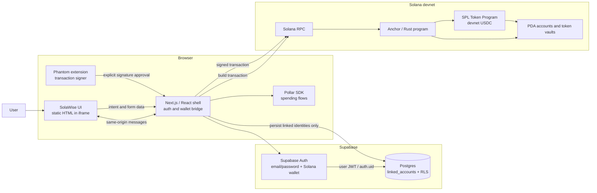

# SolaWise: Your Wealth Platform on Solana

SolaWise is a naira-first savings and payments experience built around real
Solana devnet programs. People can create personal goal vaults, coordinate
rotating Ajo circles, and use escrow-backed event tickets. Supabase provides
application accounts and private wallet-link records; Phantom approves the
app's Anchor transactions; Pollar provides its separate payment flows.


## Submission summary

- **Short description:** Naira-first wealth app on Solana: goal vaults, Ajo
  circles, yield previews and event tickets. No crypto jargon.
- **Live demo:** `http://localhost:3000`
- **Category:** DeFi
- **Project title:** SolaWise: Your Wealth Platform on Solana
- **Program network:** Solana devnet
- **Program ID:** `7g5t6wDmwmNsgSxTJKqy3gbck2PYRqTsKjXj6PGgq16h`
- **SPL asset:** Devnet USDC
  `4zMMC9srt5Ri5X14GAgXhaHii3GnPAEERYPJgZJDncDU`
- **Primary wallet/payments provider:** Pollar SDK
- **Application authentication and account links:** Supabase Auth + Postgres RLS
- **Smart-contract framework:** Anchor 1.2.2 / Rust
- **Application framework:** Next.js 15 / React 19
- **Demo network:** Solana devnet only

## What SolaWise does

### SolaWise Goals

Users create named personal goal vaults with a target and maturity date.
Devnet USDC deposits are transferred into a PDA-owned SPL-token vault. The
vault and goal account enforce maturity before withdrawal and close after funds
leave the vault.

### SolaWise Ajo

Users create or join rotating savings circles. The join transaction locks
collateral in the circle vault, join order defines payout order, and
`settle_round` uses contribution transfers and remaining member collateral to
cover missed payments. Remaining collateral can be reclaimed after the circle
completes.

### SolaWise Events

Organizers create on-chain ticket events with an SPL-mint price and capacity.
Ticket purchases and resales are held in an event escrow vault. Resale prices
are capped at 110% of face value. An organizer can cancel an event and each
buyer or resale buyer can reclaim the full sale amount. After event completion,
the current seller can claim escrowed sale proceeds.

### SolaWise Pay

Supabase email/password or Phantom wallet authentication is the SolaWise
account login. Users link a Pollar wallet separately before using
Pollar-managed send, receive, balance, transaction-history, or enabled ramp
features. Phantom is also the linked signer for SolaWise's custom Anchor
instructions. Signing in with Phantom verifies wallet ownership with a
message; it does not authorize transactions. Pollar still requires its
authenticated SDK session, and Phantom still asks the user to approve each
transaction.

### SolaWise Assistant

The Assistant is a server-side Groq integration exposed through
`/api/assistant`. It accepts bounded chat history, applies a safety-oriented
savings-system prompt, validates messages and does not expose the Groq key to
the browser. Browser speech recognition can populate a question when supported.
Reply audio is generated server-side by ElevenLabs through `/api/voice`.
Suggested app actions are allowlisted and require an explicit in-app approval
before opening a SolaWise page or review form. Transactions still require the
existing form confirmation and the user's Phantom approval; the Assistant
cannot submit transactions, transfer funds, or control the wallet.

### SolaWise Home, Stash and Profile

Home shows on-chain goal and Ajo counts. Stash shows live Phantom devnet
balances and, when linked and authenticated, Pollar-returned balances. Profile
shows the Supabase account and linked wallet addresses. Account links are
stored once per user/provider; financial activity is not copied into Supabase.
Appearance settings support system, light and dark themes.

## Why Solana

Solana provides fast confirmations and small network fees for frequent,
lower-value contributions. SolaWise uses program-derived addresses (PDAs) for
personal goal state and vaults, Ajo circle state and collateral, and event
ticket and sale escrow. SPL-token transfers happen in Anchor instructions;
Solana account state is the source of truth for these financial activities.
The configured USDC mint is a devnet test mint, not real US dollars.

## Architecture



### Identity, account links, and financial data

```mermaid
sequenceDiagram
  actor User
  participant UI as SolaWise UI
  participant Auth as Supabase Auth
  participant DB as Supabase Postgres (RLS)
  participant Wallet as Phantom / Pollar
  participant Chain as Solana devnet

  User->>UI: Sign in with email/password or Phantom
  UI->>Auth: Supabase Auth request / Sign in with Solana
  Auth->>Wallet: Request a sign-in message signature
  Wallet-->>Auth: Signed message (not a transaction)
  Auth-->>UI: Persisted user session
  opt Phantom sign-in
    UI->>DB: Persist Phantom address for this user
  end
  User->>UI: Explicitly link Pollar (optional)
  UI->>Wallet: Authenticate with Pollar
  Wallet-->>UI: Pollar wallet address and provider state
  UI->>DB: Upsert one Pollar row for this user
  DB->>DB: RLS checks auth.uid() = user_id
  User->>UI: Create goal, contribute, settle, or buy ticket
  UI->>Chain: Submit transaction signed in Phantom
  Chain-->>UI: Signature and updated program accounts
  Note over DB,Chain: Supabase stores account links only; financial state remains on-chain.
```

### Responsibilities by layer

| Layer | Responsibility |
| --- | --- |
| `public/solawise.html` | Savings, Ajo, event, payments, assistant and profile UI. |
| `app/pollar-shell.tsx` | Supabase session lifecycle, top-level auth UI, origin-checked iframe messages, Pollar SDK and Phantom extension bridges. |
| `app/supabase.ts` | Browser Supabase client using only the public publishable key. |
| `supabase/migrations/` | Postgres schema and row-level access rules for linked wallet identities. |
| `app/anchor-program.ts` | Reads devnet program accounts and builds/submits typed Anchor instructions. |
| `programs/solawise/src/lib.rs` | Rust/Anchor instructions, account constraints, PDA state and SPL-token escrow rules. |
| Pollar SDK | Provider-managed account and supported payment flows; separate from app auth and Phantom signing. |
| Phantom | Holds the user's keys and explicitly signs SolaWise Solana transactions. |
| Groq / ElevenLabs | Server-side assistant text and optional speech generation; neither provider receives wallet addresses or balances from app context. |

### Supabase data model and security

- Supabase Auth owns SolaWise email/password and Solana-wallet accounts, and
  persists sessions. Phantom signs a domain-bound sign-in message; this is not
  a transaction and does not authorize token movement.
- `public.linked_accounts` stores one Pollar wallet and one Phantom address per
  Supabase user. Its `(user_id, provider)` primary key makes linking idempotent:
  reconnecting the same account updates the same row instead of creating
  duplicate history.
- Row-level security restricts reads and writes to `auth.uid() = user_id`.
- The browser uses a Supabase publishable key only. No service-role key is used
  or sent to the browser.
- Supabase does **not** store balances, deposits, Ajo contributions, ticket
  sales, or payment history. Those remain on Solana or within Pollar's own
  provider account/history.
- A linked address is an account association, not proof of signing authority.
  The app still requires a live authenticated Pollar session for Pollar actions
  and a connected Phantom signer plus wallet approval for Anchor transactions.
- Signing out clears the Supabase session, Pollar session, and Phantom site
  connection. The linked-account rows remain so the user can link again after
  signing in.

## Pollar integration

The app uses:

- `@pollar/core`
- `@pollar/react`

The browser provider uses a publishable test-mode key and cached client
configuration. Supabase is the app login; Pollar authentication is requested
only when the user links Pollar for spending. Pollar wallets use `ON_DEMAND` or
`AT_LOGIN` provisioning when configured in the dashboard. Phantom connects
directly and signs Anchor transactions from the app's parent frame.

Pollar-managed custody is intentionally separated from external-wallet signing:
Pollar payment flows can operate on a Pollar wallet, while custom goal, Ajo and
ticket instructions require the connected Phantom signer. Supported Pollar
send/receive, balance and history modals are wired directly to the SDK. Pollar
is needed for the Pollar Payments track, but is not a requirement for Solana
devnet deployment or the overall/DeFi tracks.

## Supabase integration

The linked-account migration has been applied to the configured project.
Configure Supabase Auth to enable both the Email provider and the Web3 Wallet
provider with Solana enabled. The app supports email/password and Phantom
wallet sign-in through Supabase Auth. The browser session is persisted by
`@supabase/supabase-js`; database access is constrained by the migration's RLS
policies.

To allow email/password sign-up and sign-in without an email verification
code, turn **off Confirm email** under Supabase Authentication > Providers >
Email. With confirmation enabled, Supabase intentionally withholds a session
until the user confirms their email; the app reports this configuration issue
and does not bypass the provider. Also avoid enabling an MFA policy that
requires an additional challenge if the experience must never request a code.
Phantom sign-in does not use email or a verification code: the user approves a
domain-bound sign-in message in the wallet. Wallet message approval
authenticates the account only; each on-chain transaction still requires a
separate Phantom transaction approval.

Set Supabase Site URL and allowed redirect URLs to include
`http://localhost:3000` and the deployed app origin. No email SMTP or OTP is
needed for the no-confirmation email/password flow or Solana wallet sign-in.

See Supabase's [password authentication guide](https://supabase.com/docs/guides/auth/passwords),
[Sign in with Web3 guide](https://supabase.com/docs/guides/auth/auth-web3), and
[row-level security guide](https://supabase.com/docs/guides/database/postgres/row-level-security)
for project setup details.

The Pollar and Phantom links are explicit user actions. Pollar's authenticated
Solana wallet address and the connected Phantom public key are stored in the
current Supabase user's single provider row. Changing the connected address
updates that provider row; it does not create financial activity or a payment
ledger in Supabase.

## AI assistant integration

The Assistant uses a server-only `GROQ_API_KEY` and defaults to
`openai/gpt-oss-120b`. Groq is called only from the Next.js server route.
Wallet addresses, balances and on-chain account data are not included in
assistant prompts; the app sends only goal/circle names and event titles and
statuses, plus wallet/program readiness booleans, so the Assistant can suggest
matching app pages. Invalid or provider-failed requests produce explicit UI
errors instead of canned success responses. Spoken replies require server-only
`ELEVENLABS_API_KEY` and
`ELEVENLABS_VOICE_ID` configuration. Neither key is exposed to the browser.

## Solana program architecture

The custom Rust/Anchor program implements:

- Personal goal accounts and PDA vaults
- Goal creation, SPL deposits and maturity-controlled withdrawal
- Ajo creation, joining, collateral, contributions and round settlement
- Automatic collateral coverage for missed Ajo payments
- Collateral reclaim after circle completion
- Event, ticket and ticket-sale accounts
- 10%-capped resale
- Event cancellation refunds
- Post-event sale settlement

The program PDA namespaces include `goal`, `goal_vault`, `circle`,
`circle_vault`, `event`, `event_vault`, `ticket` and `ticket_sale`.

### Anchor instruction lifecycles

| Product flow | Anchor instructions | On-chain effect |
| --- | --- | --- |
| Personal goal | `create_goal`, `deposit_goal`, `withdraw_goal` | Creates a goal PDA and token vault; transfers SPL tokens in; enforces maturity before withdrawal. |
| Ajo circle | `create_circle`, `join_circle`, `contribute`, `settle_round`, `claim_collateral` | Stores member and round order; escrows collateral and contributions; settles payouts and missed-payment coverage; returns remaining collateral. |
| Event tickets | `create_event`, `buy_ticket`, `list_ticket`, `unlist_ticket`, `buy_resale` | Stores event/ticket/sale PDAs and holds payment in the event vault; limits resale price to 110% of face value. |
| Event lifecycle | `cancel_event`, `complete_event`, `refund_ticket_sale`, `settle_ticket_sale` | Cancels and enables refunds, marks completion, refunds escrow or releases eligible sale proceeds. |

`app/anchor-program.ts` derives PDAs, reads account snapshots over Solana RPC,
builds the typed instructions and hands transactions to the connected signer.
The Rust program in `programs/solawise/src/lib.rs` validates signers, account
relationships, lifecycle state and SPL-token movements. Phantom is the signer;
Supabase account links never replace on-chain authorization.

## Devnet deployment

- Program: `7g5t6wDmwmNsgSxTJKqy3gbck2PYRqTsKjXj6PGgq16h`
- Cluster: Solana devnet
- Address:
  [SolaWise devnet program](https://explorer.solana.com/address/7g5t6wDmwmNsgSxTJKqy3gbck2PYRqTsKjXj6PGgq16h?cluster=devnet)
- Devnet USDC mint:
  `4zMMC9srt5Ri5X14GAgXhaHii3GnPAEERYPJgZJDncDU`
- IDL metadata account:
  `HEnji31L78CFZtVNz4pmkXe9QMwqYJsPaxPKXpJqvxF`

## Local setup

Requirements: Node.js 22+, npm, Rust, Solana CLI and Anchor 1.2.2.

```bash
npm ci
cp .env.example .env.local
npm run dev
```

Set these environment variables in `.env.local`:

```text
NEXT_PUBLIC_POLLAR_PUBLISHABLE_KEY=<Pollar test-mode publishable key>
POLLAR_SECRET_KEY=<Pollar server-only secret>
NEXT_PUBLIC_SUPABASE_URL=https://<project-ref>.supabase.co
NEXT_PUBLIC_SUPABASE_PUBLISHABLE_KEY=<Supabase publishable key>
GROQ_API_KEY=<Groq server-only key>
GROQ_MODEL=openai/gpt-oss-120b
ELEVENLABS_API_KEY=<ElevenLabs server-only key>
ELEVENLABS_VOICE_ID=<ElevenLabs voice ID>
NEXT_PUBLIC_SOLAWISE_MINT=4zMMC9srt5Ri5X14GAgXhaHii3GnPAEERYPJgZJDncDU
```

Never prefix the Pollar secret, Groq key, or ElevenLabs key with
`NEXT_PUBLIC_`. Do not add a Supabase service-role key; the browser needs only
the publishable key, with RLS enforcing access.

Apply the SQL migration in the Supabase SQL editor or with the Supabase CLI:

```bash
supabase db push
```

In Supabase Auth settings, enable the Email provider and Web3 Wallet > Solana.
Disable **Confirm email** to avoid verification codes for email/password
accounts. Set the Site URL and allowed redirect URLs to include
`http://localhost:3000` and the deployed app origin. Phantom users authenticate
by approving a sign-in message; no email address or verification code is
required.

In the Pollar dashboard:

1. Allow `http://localhost:3000` and the deployed demo origin.
2. Enable Solana on testnet.
3. Set wallet provisioning to `ON_DEMAND` or `AT_LOGIN`.
4. Enable the supported Solana assets that should appear in balances.
5. Confirm send, receive and local-ramp routes for the demo.

Open `http://localhost:3000`, create/sign into a SolaWise account, then link
Pollar for supported spending and Phantom for Solana transactions. Use devnet
assets only.

## Build and deploy

If the standard `anchor build` toolchain reports a missing
`librustc_driver` from platform-tools v1.57, build with v1.58:

```bash
cargo-build-sbf --tools-version v1.58 \
  --manifest-path programs/solawise/Cargo.toml
anchor idl build -p solawise \
  -o target/idl/solawise.json \
  -t target/types/solawise.ts
```

Deploy or upgrade the program:

```bash
solana program deploy target/deploy/solawise.so \
  --program-id 7g5t6wDmwmNsgSxTJKqy3gbck2PYRqTsKjXj6PGgq16h \
  --upgrade-authority .anchor/wallet.json \
  --keypair .anchor/wallet.json \
  --url devnet \
  --max-len 500000

anchor idl upgrade \
  --filepath target/idl/solawise.json \
  7g5t6wDmwmNsgSxTJKqy3gbck2PYRqTsKjXj6PGgq16h \
  --provider.cluster devnet \
  --provider.wallet .anchor/wallet.json
```

Never publish `.anchor/wallet.json` or any keypair/secret.

## Tests

The integration suite uses a local SPL mint and a local Solana validator. It
covers:

- Goal maturity lock and post-maturity withdrawal
- Ajo join order, payouts and missed-payment collateral
- Remaining Ajo collateral claims
- Ticket resale at the 10% cap
- Ticket unlisting
- Full refunds for original and resale purchases after cancellation
- Escrow payout only after event completion

```bash
anchor test --skip-build --validator legacy
npm run build
```

## Demo flow

1. Sign up or sign in with SolaWise email/password or authenticate with a
   Phantom-signed Solana login message (Supabase).
2. Link Phantom to load and sign on-chain devnet actions. When using Phantom to
   authenticate, that wallet is linked to the account automatically.
3. Optionally link Pollar for provider-managed spending and balances.
4. Open Stash and inspect the connected devnet wallet balances.
5. Open Save and create or fund an on-chain goal.
6. Create an Ajo, join members and settle a round.
7. Open Events and create or browse an on-chain ticket event.
8. Purchase, resell, cancel or settle a devnet ticket according to the
   event lifecycle.
9. Open Pay to use Pollar send/receive/balance/history or enabled ramp routes.
10. Open Assistant for server-side AI guidance and approve any proposed app
    navigation before it opens.

## Submission track fit

- **Best App Overall / unique Rust project:** custom Anchor PDA accounts,
  devnet deployment, goal/Ajo/ticket escrow and a complete React wallet UX.
- **Best DeFi App:** on-chain vaults, collateralized rotating savings and
  escrowed ticket settlement.
- **Best Agentic App:** server-side Groq Assistant with bounded chat history;
  safe allowlisted actions require explicit in-app approval, and transactions
  still require the existing review form and Phantom confirmation.
- **Best Solana app using Supabase:** Supabase email/password Auth, persisted
  provider links, and user-scoped Postgres RLS; financial activity remains
  verifiable on Solana rather than being duplicated in a database.
- **Pollar Payments:** Pollar SDK authentication, account linking, wallet
  provisioning, send/receive, balance, history and configured ramp flows.

These are implementation choices and track-fit explanations, not a guarantee of
eligibility or a prize outcome.

## Integration readiness

The application code, Supabase browser client, RLS migration, wallet-link
upserts, and architecture documentation are included in this repository.
Live Supabase sign-up and wallet persistence require a configured Supabase
project, the two public environment variables above, and the migration to be
applied. Confirm the email redirect settings before testing sign-up. Pollar
payment flows also require the local app origin to be allowed in the Pollar
dashboard. Until those external settings are complete, do not treat an
unconfigured local environment as a verified end-to-end deployment.

## Prototype scope

SolaWise uses Solana devnet test assets and is a non-custodial hackathon
prototype, not a regulated financial product. Goal vaults, Ajo circles and
ticket escrow are real Anchor instructions on devnet. Yield and treasury cards,
Nigerian bill providers, and live NGN ramp settlement remain previews or
provider-controlled features; do not present them as live until the required
external integrations are configured and tested.
