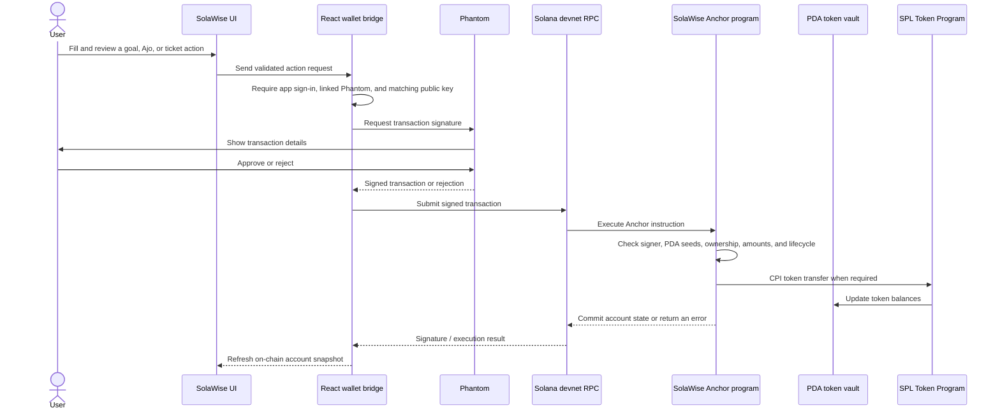
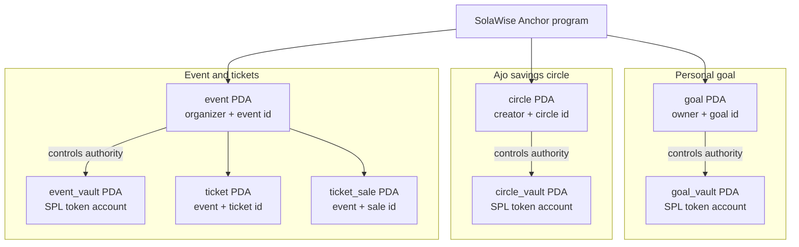

# SolaWise: Your Wealth Platform on Solana

SolaWise is a naira-first savings and payments experience built around real
Solana devnet programs. People can create personal goal vaults, coordinate
rotating Ajo circles, and use escrow-backed event tickets. Supabase provides
application accounts and private wallet-link records; Phantom approves the
app's Anchor transactions; Pollar provides its separate payment flows.


## Submission summary

- **Short description:** Naira-first wealth app on Solana: goal vaults, Ajo
  circles, yield previews and event tickets. No crypto jargon.
- **Run locally:** `http://localhost:3000` (no public demo URL is configured)
- **Category:** DeFi
- **Project title:** SolaWise: Your Wealth Platform on Solana
- **Program network:** Solana devnet
- **Program ID:** `7g5t6wDmwmNsgSxTJKqy3gbck2PYRqTsKjXj6PGgq16h`
- **SPL asset:** Devnet USDC
  `4zMMC9srt5Ri5X14GAgXhaHii3GnPAEERYPJgZJDncDU`
- **Primary wallet/payments provider:** Pollar SDK
- **Application authentication and account links:** Supabase Auth + Postgres RLS
- **Smart-contract framework:** Anchor 1.2.2 / Rust
- **Application framework:** Next.js 15 / React 19
- **Demo network:** Solana devnet only

## What SolaWise does

### SolaWise Goals

Users create named personal goal vaults with a target and maturity date.
Devnet USDC deposits are transferred into a PDA-owned SPL-token vault. The
vault and goal account enforce maturity before withdrawal and close after funds
leave the vault.

### SolaWise Ajo

Users create or join rotating savings circles. The join transaction locks
collateral in the circle vault, join order defines payout order, and
`settle_round` uses contribution transfers and remaining member collateral to
cover missed payments. Remaining collateral can be reclaimed after the circle
completes.

### SolaWise Events

Organizers create on-chain ticket events with an SPL-mint price and capacity.
Ticket purchases and resales are held in an event escrow vault. Resale prices
are capped at 110% of face value. An organizer can cancel an event and each
buyer or resale buyer can reclaim the full sale amount. After event completion,
the current seller can claim escrowed sale proceeds.

### SolaWise Pay

Supabase email/password or Phantom wallet authentication is the SolaWise
account login. Users link a Pollar wallet separately before using
Pollar-managed send, receive, balance, transaction-history, or enabled ramp
features. Phantom is also the linked signer for SolaWise's custom Anchor
instructions. Signing in with Phantom verifies wallet ownership with a
message; it does not authorize transactions. Pollar still requires its
authenticated SDK session, and Phantom still asks the user to approve each
transaction.

### SolaWise Assistant

The Assistant is a server-side Groq integration exposed through
`/api/assistant`. It accepts bounded chat history, applies a safety-oriented
savings-system prompt, validates messages and does not expose the Groq key to
the browser. Browser speech recognition can populate a question when supported.
Reply audio is generated server-side by ElevenLabs through `/api/voice`.
Suggested app actions are allowlisted and require an explicit in-app approval
before opening a SolaWise page or review form. Transactions still require the
existing form confirmation and the user's Phantom approval; the Assistant
cannot submit transactions, transfer funds, or control the wallet.

### SolaWise Home, Stash and Profile

Home shows on-chain goal and Ajo counts. Stash shows live Phantom devnet
balances and, when linked and authenticated, Pollar-returned balances. Profile
shows the Supabase account and linked wallet addresses. Account links are
stored once per user/provider; financial activity is not copied into Supabase.
Appearance settings support system, light and dark themes.

### Live features and previews

| Surface | What works | Important boundary |
| --- | --- | --- |
| Goals | Create goals, deposit devnet tokens, and withdraw after maturity through Anchor. | Uses the configured devnet mint; not real USDC or a bank savings account. |
| Ajo | Create/join circles, contribute, settle rounds, and claim remaining collateral on-chain. | Members must use compatible token accounts and follow the on-chain round schedule. |
| Events | Create events, buy/list/unlist/resell tickets, cancel/refund, and settle eligible sales on-chain. | Ticket resale is capped at 110% of face value by the program. |
| Phantom | Supabase wallet sign-in, explicit message signing, and transaction signing. | A login message is not a transaction; each transaction requires a separate wallet review and approval. |
| Pollar | Provider-authenticated wallet, supported send/receive, balances, history, and configured ramps. | Available assets, routes and settlement depend on Pollar project configuration. |
| Assistant | Groq text replies; ElevenLabs speech output when configured; allowlisted, user-approved navigation/review proposals. | It cannot submit transactions or move money. Speech input uses browser speech recognition where supported. |
| Bills, NGN conversion, yield and treasury | UI previews and simulations for product exploration. | Not connected to a live bill provider, NGN on/off-ramp, or yield strategy; simulations do not transfer funds. |

## Why Solana

Solana provides fast confirmations and small network fees for frequent,
lower-value contributions. SolaWise uses program-derived addresses (PDAs) for
personal goal state and vaults, Ajo circle state and collateral, and event
ticket and sale escrow. SPL-token transfers happen in Anchor instructions;
Solana account state is the source of truth for these financial activities.
The configured USDC mint is a devnet test mint, not real US dollars.

## Architecture and trust boundaries

```mermaid
flowchart LR
  person[User]
  subgraph browser[User browser]
    ui[SolaWise UI<br/>same-origin HTML iframe]
    shell[Next.js / React shell<br/>auth and wallet bridge]
    phantom[Phantom<br/>Solana wallet]
    pollar[Pollar SDK<br/>provider wallet and payments]
  end
  subgraph supabase[Supabase]
    auth[Supabase Auth<br/>email/password and Solana SIWS]
    db[(Postgres<br/>linked_accounts + RLS)]
  end
  subgraph server[Next.js server routes]
    assistant[/api/assistant]
    voice[/api/voice]
  end
  groq[Groq]
  eleven[ElevenLabs]
  subgraph solana[Solana devnet]
    rpc[Solana RPC]
    program[Anchor program<br/>Rust]
    token[SPL Token Program]
    pda[PDA state and token vaults<br/>devnet test mint]
  end
  person --> ui
  ui <-->|origin-checked postMessage| shell
  shell -->|sign in / restore session| auth
  auth -->|user session JWT| shell
  shell -->|JWT-scoped reads and upserts; RLS checks auth.uid()| db
  shell <-->|explicit connect and payment actions| pollar
  shell -->|read accounts / submit signed tx| rpc
  shell <-->|message or transaction approval| phantom
  rpc --> program
  program --> pda
  program --> token
  token --> pda
  ui -->|user chat + limited app context| assistant
  assistant --> groq
  groq --> assistant
  assistant --> ui
  ui -->|reply text for speech| voice
  voice --> eleven
  eleven --> voice
  voice --> ui
```

The browser builds and requests transactions; the connected wallet controls
signing, and the Solana program validates and executes state changes. Supabase
stores account identity links, not a financial ledger. Assistant and voice
requests go through server-only API routes so provider credentials are not
exposed to the browser. Automatically attached assistant context excludes
wallet addresses and balances; user-entered chat messages are sent to Groq.

### Identity, account links, and financial data

```mermaid
sequenceDiagram
  actor User
  participant UI as SolaWise UI
  participant Auth as Supabase Auth
  participant DB as Supabase Postgres (RLS)
  participant Wallet as Phantom / Pollar
  participant Chain as Solana devnet

  alt Email and password
    User->>UI: Submit sign-up or sign-in form
    UI->>Auth: Supabase email/password request
  else Phantom wallet
    User->>UI: Choose Phantom sign-in
    UI->>Wallet: Request a domain-bound sign-in message signature
    Wallet->>User: Show message for approval
    User->>Wallet: Approve message
    Wallet-->>UI: Signed message (not a transaction)
    UI->>Auth: Supabase verifies Sign in with Solana message
  end
  Auth-->>UI: Persisted user session
  opt Phantom sign-in
    UI->>DB: Persist Phantom address for this user
  end
  User->>UI: Explicitly link Pollar (optional)
  UI->>Wallet: Authenticate with Pollar
  Wallet-->>UI: Pollar wallet address and provider state
  UI->>DB: Upsert one Pollar row for this user
  DB->>DB: RLS checks auth.uid() = user_id
  User->>UI: Create goal, contribute, settle, or buy ticket
  UI->>Chain: Submit transaction signed in Phantom
  Chain-->>UI: Signature and updated program accounts
  Note over DB,Chain: Supabase stores account links only; financial state remains on-chain.
```

### On-chain transaction lifecycle



### PDA and escrow map



PDA accounts hold program state and provide deterministic addresses; token
vaults are SPL Token accounts whose authorities are their associated program
state PDAs. User wallets sign instructions, while the program's PDA signer
seeds authorize eligible vault transfers. Exact account constraints and
lifecycle checks live in the Anchor program.

### Responsibilities by layer

| Layer | Responsibility |
| --- | --- |
| `public/solawise.html` | Savings, Ajo, event, payments, assistant and profile UI. |
| `app/pollar-shell.tsx` | Supabase session lifecycle, top-level auth UI, origin-checked iframe messages, Pollar SDK and Phantom extension bridges. |
| `app/supabase.ts` | Browser Supabase client using only the public publishable key. |
| `supabase/migrations/` | Postgres schema and row-level access rules for linked wallet identities. |
| `app/anchor-program.ts` | Reads devnet program accounts and builds/submits typed Anchor instructions. |
| `programs/solawise/src/lib.rs` | Rust/Anchor instructions, account constraints, PDA state and SPL-token escrow rules. |
| `target/idl/solawise.json` | Generated Anchor IDL consumed by the TypeScript client; generated by Anchor build tooling. |
| `tests/solawise.ts` | Local-validator integration tests for goal, Ajo and event lifecycles. |
| `app/api/assistant/route.ts` | Validates assistant requests and calls Groq from the server. |
| `app/api/voice/route.ts` | Validates speech requests and calls ElevenLabs from the server. |
| Pollar SDK | Provider-managed account and supported payment flows; separate from app auth and Phantom signing. |
| Phantom | Holds the user's keys and explicitly signs SolaWise Solana transactions. |
| Groq / ElevenLabs | Server-side assistant text and optional speech generation; the app does not attach wallet addresses or balances to provider context. |

### Supabase data model and security

- Supabase Auth owns SolaWise email/password and Solana-wallet accounts, and
  persists sessions. Phantom signs a domain-bound sign-in message; this is not
  a transaction and does not authorize token movement.
- `public.linked_accounts` stores one Pollar wallet and one Phantom address per
  Supabase user. Its `(user_id, provider)` primary key makes linking idempotent:
  reconnecting the same account updates the same row instead of creating
  duplicate history.
- Row-level security restricts reads and writes to `auth.uid() = user_id`.
- The browser uses a Supabase publishable key only. No service-role key is used
  or sent to the browser.
- The `linked_accounts` table is keyed by `(user_id, provider)`, and its
  row-level policies scope reads and writes to the authenticated user. This
  prevents duplicate provider rows per user; a relink updates that user's
  existing provider row.
- Supabase does **not** store balances, deposits, Ajo contributions, ticket
  sales, or payment history. Those remain on Solana or within Pollar's own
  provider account/history.
- A linked address is an account association, not proof of signing authority.
  The app still requires a live authenticated Pollar session for Pollar actions
  and a connected Phantom signer plus wallet approval for Anchor transactions.
- Signing out clears the Supabase session, Pollar session, and Phantom site
  connection. The linked-account rows remain so the user can link again after
  signing in.

## Pollar integration

The app uses:

- `@pollar/core`
- `@pollar/react`

The browser provider uses a publishable test-mode key and cached client
configuration. Supabase is the app login; Pollar authentication is requested
only when the user links Pollar for spending. Pollar wallets use `ON_DEMAND` or
`AT_LOGIN` provisioning when configured in the dashboard. Phantom connects
directly and signs Anchor transactions from the app's parent frame.

Pollar-managed custody is intentionally separated from external-wallet signing:
Pollar payment flows can operate on a Pollar wallet, while custom goal, Ajo and
ticket instructions require the connected Phantom signer. Supported Pollar
send/receive, balance and history modals are wired directly to the SDK. Pollar
is not required by the on-chain program, but the current frontend shell also
requires its publishable key to render the full auth and wallet UI.

## Supabase integration

The linked-account migration has been applied to the configured Supabase
project. For a new Supabase project, apply
[`supabase/migrations/20261128000000_linked_accounts.sql`](./supabase/migrations/20261128000000_linked_accounts.sql)
once before using wallet links.
Configure Supabase Auth to enable both the Email provider and the Web3 Wallet
provider with Solana enabled. The app supports email/password and Phantom
wallet sign-in through Supabase Auth. The browser session is persisted by
`@supabase/supabase-js`; database access is constrained by the migration's RLS
policies.

To allow email/password sign-up and sign-in without an email verification
code, turn **off Confirm email** under Supabase Authentication > Providers >
Email. With confirmation enabled, Supabase intentionally withholds a session
until the user confirms their email; the app reports this configuration issue
and does not bypass the provider. Also avoid enabling an MFA policy that
requires an additional challenge if the experience must never request a code.
Phantom sign-in does not use email or a verification code: the user approves a
domain-bound sign-in message in the wallet. Wallet message approval
authenticates the account only; each on-chain transaction still requires a
separate Phantom transaction approval.

Set Supabase Site URL and allowed redirect URLs to include
`http://localhost:3000` and the deployed app origin. No email SMTP or OTP is
needed for the no-confirmation email/password flow or Solana wallet sign-in.

See Supabase's [password authentication guide](https://supabase.com/docs/guides/auth/passwords),
[Sign in with Web3 guide](https://supabase.com/docs/guides/auth/auth-web3), and
[row-level security guide](https://supabase.com/docs/guides/database/postgres/row-level-security)
for project setup details.

The Pollar and Phantom links are explicit user actions. Pollar's authenticated
Solana wallet address and the connected Phantom public key are stored in the
current Supabase user's single provider row. Changing the connected address
updates that provider row; it does not create financial activity or a payment
ledger in Supabase.

## AI assistant integration

The Assistant uses a server-only `GROQ_API_KEY` and defaults to
`openai/gpt-oss-120b`. Groq is called only from the Next.js server route.
The app's automatically attached assistant context contains goal and circle
names, event titles/statuses, and wallet/program readiness booleans; it does not
include wallet addresses, balances, or raw on-chain account data. Chat messages
are sent to Groq to generate replies. The browser voice-input feature uses the
browser's speech-recognition API where available; spoken replies send the
assistant response text to the ElevenLabs server route and require
`ELEVENLABS_API_KEY` and `ELEVENLABS_VOICE_ID`. Provider keys remain server
side. Requests are bounded and invalid/provider-failed calls return explicit
errors. Assistant proposals can only open allowlisted in-app pages/review
surfaces and never submit transactions.

## Solana program architecture

The custom Rust/Anchor program implements:

- Personal goal accounts and PDA vaults
- Goal creation, SPL deposits and maturity-controlled withdrawal
- Ajo creation, joining, collateral, contributions and round settlement
- Automatic collateral coverage for missed Ajo payments
- Collateral reclaim after circle completion
- Event, ticket and ticket-sale accounts
- 10%-capped resale
- Event cancellation refunds
- Post-event sale settlement

The program PDA namespaces include `goal`, `goal_vault`, `circle`,
`circle_vault`, `event`, `event_vault`, `ticket` and `ticket_sale`.

### Anchor instruction lifecycles

| Product flow | Anchor instructions | On-chain effect |
| --- | --- | --- |
| Personal goal | `create_goal`, `deposit_goal`, `withdraw_goal` | Creates a goal PDA and token vault; transfers SPL tokens in; enforces maturity before withdrawal. |
| Ajo circle | `create_circle`, `join_circle`, `contribute`, `settle_round`, `claim_collateral` | Stores member and round order; escrows collateral and contributions; settles payouts and missed-payment coverage; returns remaining collateral. |
| Event tickets | `create_event`, `buy_ticket`, `list_ticket`, `unlist_ticket`, `buy_resale` | Stores event/ticket/sale PDAs and holds payment in the event vault; limits resale price to 110% of face value. |
| Event lifecycle | `cancel_event`, `complete_event`, `refund_ticket_sale`, `settle_ticket_sale` | Cancels and enables refunds, marks completion, refunds escrow or releases eligible sale proceeds. |

`app/anchor-program.ts` derives PDAs, reads account snapshots over Solana RPC,
builds Anchor instructions and hands transactions to the connected signer.
The Rust program in `programs/solawise/src/lib.rs` validates signers, account
relationships, lifecycle state and SPL-token movements. Phantom is the signer;
Supabase account links never replace on-chain authorization.

### Solana SDK bonus evidence

The Solana integration is application logic, not only wallet connection or
read-only RPC calls. Reviewers can trace the libraries through these paths:

| Library / SDK | Concrete use in SolaWise |
| --- | --- |
| `@anchor-lang/core` | `AnchorProvider` and `Program` load the generated IDL, fetch program accounts, construct Anchor instructions, and submit Phantom-signed transactions in [`app/anchor-program.ts`](./app/anchor-program.ts). |
| `@solana/web3.js` | Devnet `Connection`, `PublicKey`, deterministic PDA derivation, account reads, transaction composition, and confirmed submission are used by the app client and wallet bridge. |
| `@solana/spl-token` | The client reads mint decimals, derives associated token accounts, creates missing ATAs in the same transaction, and supplies the SPL Token program to Anchor instructions. |
| Anchor Rust + `anchor_spl` | [`programs/solawise/src/lib.rs`](./programs/solawise/src/lib.rs) implements goal, Ajo, event, ticket, resale, refund and settlement instructions. PDA signer seeds authorize vault transfers through SPL Token CPI. |
| Solana local-validator tests | [`tests/solawise.ts`](./tests/solawise.ts) creates a local mint and funded test wallets, then verifies goal maturity, Ajo rotation/default handling, ticket resale caps/refunds, and post-event settlement. |

This amounts to 17 custom Anchor instructions across three on-chain products,
with account constraints and program-level checks exercised by integration
tests. This is the strongest current evidence for the “consistent and
considerable use of Solana libraries and SDKs” bonus: a reviewer can trace an
action from the app's instruction builder through Phantom approval to the
Anchor program and inspect the corresponding state change on devnet.

## Devnet deployment

- Program: `7g5t6wDmwmNsgSxTJKqy3gbck2PYRqTsKjXj6PGgq16h`
- Cluster: Solana devnet
- Address:
  [SolaWise devnet program](https://explorer.solana.com/address/7g5t6wDmwmNsgSxTJKqy3gbck2PYRqTsKjXj6PGgq16h?cluster=devnet)
- Devnet USDC mint:
  `4zMMC9srt5Ri5X14GAgXhaHii3GnPAEERYPJgZJDncDU`
- IDL metadata account:
  `HEnji31L78CFZtVNz4pmkXe9QMwqYJsPaxPKXpJqvxF`

## Local setup

Requirements: Node.js 22+ and npm for the web app. Rust, Solana CLI, Anchor
1.2.2 and a local validator are additionally needed to generate the Anchor IDL,
run program tests, or deploy.

```bash
npm ci
cp .env.example .env.local
# Edit .env.local and set at least the Pollar and Supabase public values.
anchor build
npm run dev
```

Edit `.env.local` before starting the app. The frontend and Pollar provider
require a Pollar publishable key to mount the configured app shell. Supabase
keys are required for sign-in and linked-account persistence. Groq, ElevenLabs,
and a non-default mint are optional features.

| Variable | Required for | Notes |
| --- | --- | --- |
| `NEXT_PUBLIC_POLLAR_PUBLISHABLE_KEY` | App shell and Pollar provider | Use a Pollar test key (`pub_testnet_...`) for devnet. The configured shell currently expects this key even when testing Supabase or Phantom-only flows. |
| `NEXT_PUBLIC_SUPABASE_URL` | Supabase sign-in and account links | Supabase project URL. |
| `NEXT_PUBLIC_SUPABASE_PUBLISHABLE_KEY` | Supabase sign-in and account links | Browser-safe publishable key; never use a service-role key here. |
| `NEXT_PUBLIC_SOLAWISE_MINT` | Optional mint override | Defaults to the devnet USDC mint below. |
| `GROQ_API_KEY` | Assistant text responses | Server-only; the default model is `openai/gpt-oss-120b`. |
| `GROQ_MODEL` | Optional model override | Only set to a model available to your Groq account. |
| `ELEVENLABS_API_KEY` + `ELEVENLABS_VOICE_ID` | Assistant voice playback | Both server-only; omit to disable voice replies. |
| `POLLAR_SECRET_KEY` | None in the current app | Present in `.env.example` for possible server-side Pollar work, but current app code does not consume it. Do not configure or expose it without a server-side use case. |

Minimum variables to use Supabase and Phantom are:

```text
NEXT_PUBLIC_POLLAR_PUBLISHABLE_KEY=<Pollar test-mode publishable key>
NEXT_PUBLIC_SUPABASE_URL=https://<project-ref>.supabase.co
NEXT_PUBLIC_SUPABASE_PUBLISHABLE_KEY=<Supabase publishable key>
```

Never prefix a server-only key with `NEXT_PUBLIC_`. The browser must use only
the Supabase publishable key; do not add a Supabase service-role key.

The configured Supabase project already has the linked-account migration.
For a new project, run the SQL in
[`supabase/migrations/20261128000000_linked_accounts.sql`](./supabase/migrations/20261128000000_linked_accounts.sql)
once in the Supabase SQL Editor. Enable the Email provider and Web3 Wallet >
Solana. Disable **Confirm email** for email/password accounts to sign up
without email verification codes. Avoid MFA policies requiring an additional
challenge if a code-free sign-in experience is required. Set the Supabase Site
URL and allowed redirect URLs to include `http://localhost:3000` and the
deployed app origin. Phantom login requires approving a domain-bound sign-in
message; individual transactions still require separate wallet approval.

In the Pollar dashboard:

1. Allow `http://localhost:3000` and the deployed app origin.
2. Enable Solana on testnet.
3. Set wallet provisioning to `ON_DEMAND` or `AT_LOGIN`.
4. Enable the supported Solana assets that should appear in balances.
5. Confirm send, receive and local-ramp routes for the demo.

`anchor build` generates `target/idl/solawise.json`, which the frontend
imports. Because `target/` is generated and gitignored, generate the IDL after
cloning before running the Next.js app or production build. If the build
toolchain fails with the documented platform-tools `librustc_driver` error,
use the v1.58 workaround in [Build and deploy](#build-and-deploy).

Open `http://localhost:3000`, create/sign into a SolaWise account, then link
Pollar for supported spending or Phantom for Solana transactions. Use devnet
assets only.

## Build and deploy

If the standard `anchor build` toolchain reports a missing
`librustc_driver` from platform-tools v1.57, build with v1.58:

```bash
cargo-build-sbf --tools-version v1.58 \
  --manifest-path programs/solawise/Cargo.toml
anchor idl build -p solawise \
  -o target/idl/solawise.json \
  -t target/types/solawise.ts
```

Deploy or upgrade the program:

```bash
solana program deploy target/deploy/solawise.so \
  --program-id 7g5t6wDmwmNsgSxTJKqy3gbck2PYRqTsKjXj6PGgq16h \
  --upgrade-authority .anchor/wallet.json \
  --keypair .anchor/wallet.json \
  --url devnet \
  --max-len 500000

anchor idl upgrade \
  --filepath target/idl/solawise.json \
  7g5t6wDmwmNsgSxTJKqy3gbck2PYRqTsKjXj6PGgq16h \
  --provider.cluster devnet \
  --provider.wallet .anchor/wallet.json
```

Never publish `.anchor/wallet.json` or any keypair/secret.

## Tests

The integration suite uses a local SPL mint and a local Solana validator. It
covers:

- Goal maturity lock and post-maturity withdrawal
- Ajo join order, payouts and missed-payment collateral
- Remaining Ajo collateral claims
- Ticket resale at the 10% cap
- Ticket unlisting
- Full refunds for original and resale purchases after cancellation
- Escrow payout only after event completion

```bash
anchor test --skip-build --validator legacy
npm run build
```

`anchor build` must have generated the IDL and program artifacts before using
`--skip-build`. The tests create a temporary SPL mint and test accounts on the
local validator; they do not use devnet funds. For a fresh checkout, build the
program first. Keep the validator and test keypairs local.

## Demo flow

1. Sign up or sign in with SolaWise email/password or authenticate with a
   Phantom-signed Solana login message (Supabase).
2. Link Phantom to load and sign on-chain devnet actions. When using Phantom to
   authenticate, that wallet is linked to the account automatically.
3. Optionally link Pollar for provider-managed spending and balances.
4. Open Stash and inspect the connected devnet wallet balances.
5. Open Save and create or fund an on-chain goal.
6. Create an Ajo, join members and settle a round.
7. Open Events and create or browse an on-chain ticket event.
8. Purchase, resell, cancel or settle a devnet ticket according to the
   event lifecycle.
9. Open Pay to use Pollar send/receive/balance/history or enabled ramp routes.
10. Open Assistant for server-side AI guidance and approve any proposed app
    navigation before it opens.

## Submission track fit

- **Best App Overall / unique Rust project:** custom Anchor PDA accounts,
  devnet deployment, goal/Ajo/ticket escrow and a complete React wallet UX.
- **Best DeFi App:** on-chain vaults, collateralized rotating savings and
  escrowed ticket settlement.
- **Best Agentic App:** server-side Groq Assistant with bounded chat history;
  safe allowlisted actions require explicit in-app approval, and transactions
  still require the existing review form and Phantom confirmation.
- **Best Solana app using Supabase:** Supabase email/password and Solana-wallet
  Auth, persisted provider links, and user-scoped Postgres RLS; financial
  activity remains verifiable on Solana rather than being duplicated in a
  database.
- **Pollar Payments:** Pollar SDK authentication, account linking, wallet
  provisioning, send/receive, balance, history and configured ramp flows.

These are implementation choices and track-fit explanations, not a guarantee of
eligibility or a prize outcome.

## Integration readiness

The configured Supabase project has the linked-account migration applied, and
the Solana wallet authentication provider is enabled. A local or new
deployment still needs its own Supabase URL and publishable key, redirect
allowlist, email confirmation settings, and Pollar origin/provider setup. Do not
treat a successful local compilation as proof that external authentication,
Pollar payments, AI providers, or devnet transactions are configured end to
end.

## Troubleshooting

| Symptom | Check |
| --- | --- |
| Auth dialog does not open or the shell shows a Pollar configuration notice | Set `NEXT_PUBLIC_POLLAR_PUBLISHABLE_KEY` in `.env.local` and restart Next.js. The current shell requires this key even when signing in with Supabase or Phantom. |
| Email sign-up asks for a code or says to confirm email | In Supabase Auth > Providers > Email, disable **Confirm email**. Also check that an MFA policy is not requiring a challenge. |
| Phantom sign-in is unavailable or rejects the domain | Install/enable the Phantom extension, enable Web3 Wallet > Solana in Supabase, and add the exact local/deployed URL to Supabase's redirect allowlist. Approve the wallet's sign-in message. |
| Supabase link read/write fails | Confirm the `linked_accounts` migration is applied to this Supabase project, the URL and publishable key match that project, and the signed-in user session is active. RLS intentionally blocks access to another user's rows. |
| Pollar `/applications/config` returns 403 | Add the exact origin, including scheme and port (for example `http://localhost:3000`), to the Pollar dashboard allowlist. The app cannot bypass Pollar's origin check. |
| Anchor action says program or mint is unavailable | Run `anchor build` to generate the IDL, verify the program is deployed to devnet, use the configured devnet mint, and check the wallet has devnet SOL for fees and the correct SPL token account. |
| Assistant or speech playback reports not configured | Set `GROQ_API_KEY` for text. Set both `ELEVENLABS_API_KEY` and `ELEVENLABS_VOICE_ID` for speech. Restart the server after changing environment variables. |

## Prototype scope

SolaWise uses Solana devnet test assets and is a non-custodial hackathon
prototype, not a regulated financial product. Goal vaults, Ajo circles and
ticket escrow are real Anchor instructions on devnet. Yield and treasury cards,
Nigerian bill providers, and live NGN ramp settlement remain previews or
provider-controlled features; do not present them as live until the required
external integrations are configured and tested.
